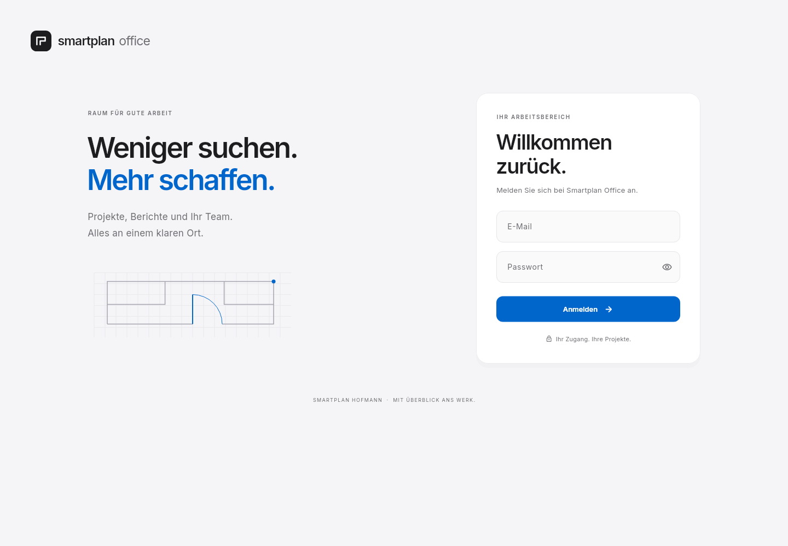
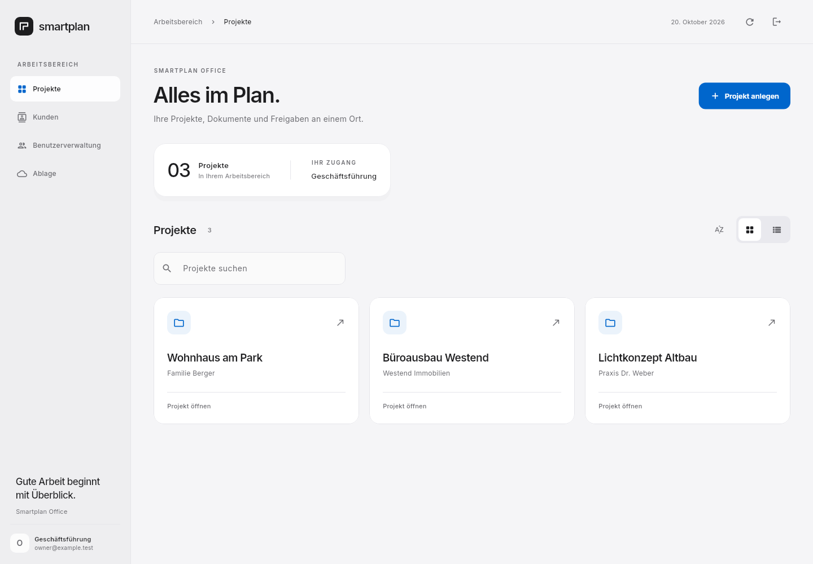
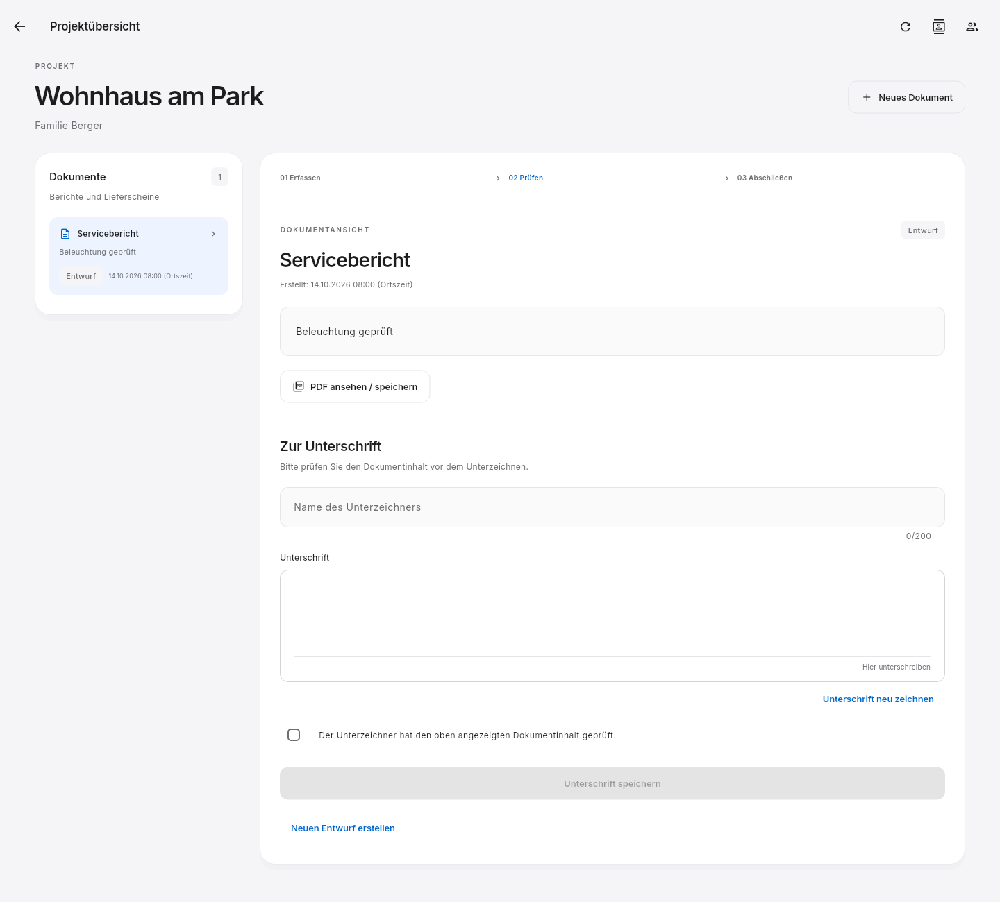

# Smartplan Office – Oberfläche 0.4.0

Die Designbasis aus Version 0.3.0 wird in 0.4.0 um
[Kundenverwaltung und Kontaktformular](KUNDENVERWALTUNG.md) erweitert.

Die neue Gestaltung orientiert sich an ruhigen Desktop-Oberflächen:
helle neutrale Flächen, Graphit für Text, Blau für Aktionen, feine Trennlinien,
klare Abstände und eine gemeinsame visuelle Hierarchie. Marke und Planzeichen
sind eigenständig für Smartplan gestaltet; es werden keine Apple-Logos oder
Apple-Schriften ausgeliefert.

## Ansichten

Die Bilder wurden aus den tatsächlichen Flutter-Widgets gerendert. Die darin
gezeigten Projekte, Personen und Berichtsinhalte sind fiktive Testdaten.
Sie werden nicht in die Anwendung oder die Nutzerdatenbank übernommen.







Weitere Ansichten: [neuer Bericht](design/previews/03-neuer-bericht.png),
[Projektzugriff](design/previews/05-projektzugriff.png),
[Team](design/previews/06-team.png), [Ablage](design/previews/07-ablage.png),
[Anmeldung mobil](design/previews/08-anmeldung-mobil.png),
[Projekte mobil](design/previews/09-projekte-mobil.png).

## Bedienung

- Die Seitenleiste öffnet Projekte, Benutzerverwaltung und Ablage. Verwaltung
  und Ablageeinrichtung stehen weiterhin nur der Geschäftsführung zur Verfügung.
  Kleine Fenster erhalten ein Navigationsmenü.
- Die Projektsuche filtert nach Name und Kunde. **Strg+F** aktiviert sie.
  Die Schaltflächen daneben sortieren alphabetisch und wechseln zwischen
  Kachel- und Listenansicht. Es werden ausschließlich freigegebene Projekte gezeigt.
- Auf großen Fenstern stehen Dokumentliste und Bearbeitung nebeneinander.
  Kleine Fenster ordnen beide Bereiche untereinander an. Der Bericht wird
  vor der Unterschrift angezeigt; Name, gezeichneter Verlauf und Inhaltsbestätigung
  bleiben erforderlich. Bereits unterzeichnete Dokumente bleiben unveränderlich.
- Benutzerrollen, Zugangssperren und Projektzuweisungen behalten die vorhandene
  Wirkung. Hinweise und Fehler erscheinen in einem gemeinsamen Format.
- Die PDF-Vorschau erhält eine deutlich sichtbare Speicheraktion.
  Dateidialog und tatsächliche PDF-Dateien verwenden weiterhin die geprüften Abläufe.
- Das Planzeichen wird auch als eigenes Windows- und iOS-App-Symbol verwendet.

Die Schrift **Inter** liegt vollständig im App-Paket. Ihre SIL Open Font License
steht unter `app/assets/fonts/OFL.txt`; sie wird nicht aus einem Webdienst geladen.
Das Symbol lässt sich mit `backend/.venv/bin/python scripts/create-brand-assets.py`
aus der ursprünglichen Vektorgeometrie reproduzieren.

## Windows-App aktualisieren

Im erfolgreichen GitHub-Actions-Lauf das neue Artefakt **Smartplan-Office-Windows**
herunterladen. App und bisherigen Starter schließen und das gesamte ZIP in einen
neuen Ordner entpacken. Darin **Starten.cmd** öffnen. Es findet die beiliegende
EXE automatisch, verwendet die vorhandene Python-Umgebung und liest die bisherige
Startkonfiguration unter `%LOCALAPPDATA%\SmartplanOffice\start-config.json`.
Der dadurch gespeicherte Datenordner wird auch nach einer früheren Wiederherstellung
weiterverwendet. Konten und Daten werden nicht ersetzt.

Die neue EXE muss gemeinsam mit DLLs und dem Flutter-Ordner `data` entpackt bleiben.
Der kleine frühere Starter-ZIP allein enthält die neue Oberfläche nicht.
Nach dem Wechsel eine vorhandene Desktop-Verknüpfung auf das neue `Starten.cmd`
umstellen. Ein alter manuell gestarteter Server muss vorher mit Strg+C beendet werden.

## Prüfung

Neben den bestehenden Transport-, Rechte- und Unterschriftentests prüfen fünf
zusätzliche Oberflächentests Suche, Sortierung, Ansichtswechsel, Navigation,
Dokumente in schmalen Fenstern, kurze Desktop-Fenster und 150 % Textskalierung.
Die Client-/Backend-Integration verwendet weiterhin einen echten Python-Server.
Ein gerendertes Mobilbild und ein Simulator-Build ersetzen keine Abnahme auf
einem echten iPhone. Diese Entwicklungsstufe bleibt ein lokaler Windows-Pilot.

Ansichten bei Bedarf neu erzeugen:

```bash
cd app
flutter test test/design_test.dart --dart-define=DESIGN_PREVIEW=true
```

Der normale CI-Testlauf schreibt keine Vorschau-Dateien.
