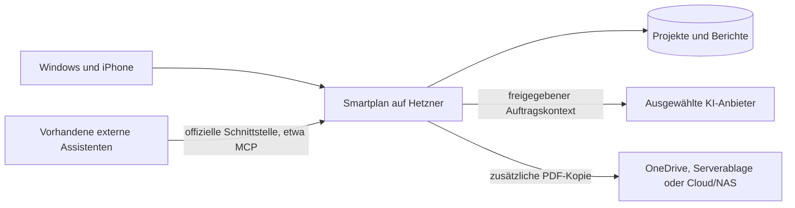

# Mehrere KI-Assistenten für Smartplan

Konzeptstand vom 23. Oktober 2026. Der Nutzer möchte größere Updatepakete,
mehrere Anbieter und eigene bestehende Assistenten einbinden. Seine ersten
Aufgaben sind inzwischen konkret: multimodales Aufmaß, bearbeitbare Pläne und
sprachgesteuerte Gerätepositionen. Bestätigte Autonomie: Routinearbeiten
automatisch nach festgelegten Regeln, wichtige Aktionen mit Freigabe.
Dies dokumentiert das Zielbild, keine bereits laufenden KI-Verbindungen.

Verwendete Produkte laut Nutzer: Grok-Bot, „ChatGPT Work“ und Codex. Der genaue
offizielle Anschluss des als „ChatGPT Work“ bezeichneten Produkts wird beim
Verbinden geprüft; daraus wird kein automatischer API-Zugang abgeleitet.

## Zielbild

Projektmanagement, Benutzer, Datenbank und Original-PDFs bleiben auf dem
vorhandenen Hetzner-Server. Optionale PDF-Kopien liegen in der gewählten
Dokumentablage. Für eine externe KI werden nur die für ihren Auftrag
freigegebenen Inhalte an den ausgewählten Anbieter übermittelt. Die Ablage der
Datenbank auf Hetzner bedeutet nicht, dass ein externer KI-Aufruf ohne solche
Datenübermittlung auskommt. Lokale Modelle wären ein eigener späterer Anschluss.

## Zwei Zugänge zur selben Fachlogik

1. **Assistenten in Smartplan:** Nutzer wählen einen benannten Assistenten, etwa
   Büroassistenz, Projektassistenz oder Berichtsassistenz. Anbieter und Modell,
   Arbeitsanweisungen, erlaubte Projekte und Befugnisse sind getrennte Einstellungen.
   Eine serverseitige Anbieterschicht kann OpenAI, Anthropic und xAI anbinden.
   Ein Modellwechsel verändert nicht die Smartplan-Fachregeln.
2. **Vorhandene externe Assistenten:** Ein Smartplan-Werkzeugzugang, beispielsweise
   ein MCP-Server, bietet dieselben begrenzten Fachfunktionen an. Ob ChatGPT,
   Codex, Claude oder ein Grok-Bot diesen Zugang nutzen kann, wird am konkreten
   Produkt und Konto geprüft. Bestehende Anweisungen, Chats und Erinnerungen
   werden dadurch nicht automatisch übernommen. Ein Consumer-Chat-Abo ist kein
   Nachweis eines nutzbaren API-Zugangs oder API-Guthabens.

MCP ist eine Werkzeug-Schnittstelle; es ersetzt weder ein KI-Modell noch dessen
Nutzerkonto. Für eingebaute Assistenten und externe Zugriffe gelten dieselben
Projekt- und Werkzeugfreigaben.

## Vom Nutzer gewählte erste Arbeitsabläufe

| Arbeitsablauf | Konkretes Ergebnis | Schon vorhandene Grundlage |
| --- | --- | --- |
| Aufmaß per Sprache, Foto und kurzem Video | Transkript, Zusammenfassung, ausdrücklich genannte Maße und Beobachtungen mit Quellen | Projekte, Rechte und spätere Übernahme in Berichtentwürfe |
| Skizze oder vorhandenen Plan einlesen | Prüffähiger, bearbeitbarer 2D-Plan mit Wänden, Räumen und Öffnungen | Neues Planmodul erforderlich; bisher nur Dokument-/Berichtsfunktionen |
| Im Plan Geräte und Notizen anlegen | Wand antippen und beispielsweise „hier zwei Steckdosen“ sagen; echte Planobjekte mit Rückgängig | Neues Plan-/Gerätemodell und begrenzte Agentenwerkzeuge erforderlich |

Das konkrete Erfassungs-, Geometrie- und Exportkonzept steht in
[AUFMASS_UND_PLAENE.md](AUFMASS_UND_PLAENE.md). Der Nutzer verwendet ein iPhone 17;
die Grundfunktionen setzen keinen LiDAR-Sensor voraus. Ein unterstützter
Raumscan wäre eine zusätzliche, zur Laufzeit geprüfte Erfassungsart.
Reguläre Rundgangvideos und freie Skizzen sind keine verlässlichen Maßnachweise.
Der Nutzer kann meistens mindestens ein gemessenes Maß ergänzen, aber nicht
bei jeder Vorlage. Unbekannte Maße bleiben kenntlich und werden nicht erfunden.

DXF und PDF sind die ersten vorgesehenen Ausgaben, unabhängig von einem
bestimmten CAD-Zielprogramm. DWG ist ein zusätzlicher Anschluss über einen
geeigneten Konverter nach Prüfung seiner Verfügbarkeit und Lizenzbedingungen.
Kundenstammdaten bleiben auf die dafür berechtigten Benutzer
beschränkt. Aufgabenverwaltung, Terminplanung, Angebote, E-Mail und WhatsApp
benötigen ihre jeweiligen Fachmodule beziehungsweise Kontoverbindungen und
werden nicht als bereits nutzbare Agentenwerkzeuge ausgegeben.

In der App sind ein Bereich **Assistenten**, ein projektbezogener Assistent und
ein Eingang **Vorschläge und Aktivitäten** vorgesehen. Ergebnisse nennen
Auftrag, Projekt, Quellen und die vorgeschlagene Änderung. Nutzer können sie
ansehen, bearbeiten, übernehmen oder verwerfen. Ausgeführte Arbeiten und Fehler
bleiben nachvollziehbar.

## Aktive Unterstützung

Bestätigtes Ziel ist **Routinearbeiten automatisch nach festgelegten Regeln;
wichtige Aktionen mit Freigabe**. Die Einstellungen pro Assistent erlauben:

- **Auf Anfrage:** Der Nutzer startet einen Auftrag.
- **Automatisch vorbereiten:** Ein freigegebenes Ereignis oder ein Zeitplan
  erzeugt einen Vorschlag, etwa nach einem neuen Projektbericht.
- **Freigegebene Arbeiten ausführen:** Klar benannte Routineaktionen dürfen im
  zugewiesenen Umfang selbst ausgeführt werden. Ausdrücklich angeforderte Geräte
  und Notizen können in der Arbeitsfassung mit Rückgängig entstehen. Bestätigte
  Maße, Wandgeometrie und freigegebene Planstände werden über Änderungsvorschläge
  bearbeitet; unklare Zahlen werden zur Prüfung gestellt.

Mehrere Assistenten können verschiedene Aufgaben haben und Ergebnisse
weiterreichen. Eine Weitergabe erweitert weder Projektumfang noch Befugnisse.
Arbeitsteilung und konkrete Ergebnisse stehen vor einer unbeschränkten
gegenseitigen Beauftragung der Agenten.

## Technische Grundlage für die Umsetzung

- Ein gemeinsamer Werkzeugdienst nutzt vorhandene Fachoperationen. Pro Aufruf
  gilt die Schnittmenge aus aktuellen Benutzerrechten, freigegebenen Projekten
  und erlaubten Werkzeugen. Ein projektbezogener Auftrag erhält nicht automatisch
  alle Projekte eines Geschäftsführungszugangs.
- Externe Assistenten brauchen einen eigenen erteilten, begrenzten und
  widerrufbaren Zugang. Erteilung erfolgt durch einen angemeldeten berechtigten
  Nutzer. Die bestehende MFA-Anmeldung wird nicht umgangen; die OneDrive-
  Anmeldung ist kein Zugang für KI-Werkzeuge.
- Längere Aufträge laufen in einem eigenen Worker mit dauerhafter PostgreSQL-
  Warteschlange, Status, Abbruch, Zeitlimit und begrenzten Wiederholungen.
  Freigaben werden vor Werkzeugaufrufen und vor Ergebnisübernahme erneut geprüft.
  Hintergrundaufträge benötigen ausdrücklich erteilte Delegationen; eine
  App-Sitzung wird nicht stillschweigend zum unbegrenzten Dienstkonto.
- Wiederholtes Übernehmen erzeugt keine doppelten Berichte, Kunden oder Projekte.
  Änderungen beziehen sich auf eine bestimmte Dokumentversion. Unterschriften
  werden nicht durch Agenten erzeugt; signierte Dokumente bleiben unveränderlich.
- Anbieterzugänge bleiben geschützt auf dem Server. Pro Anschluss und Assistent
  sind Nutzungsgrenzen, Tokenverbrauch und nachvollziehbare Kosten vorgesehen.
  Echte Aufrufe beginnen erst nach Einrichtung des jeweiligen Zugangs und Budgets.
- Dokumenttexte und externe Nachrichten sind Arbeitsdaten. Sie können keine
  Projektfreigaben, Werkzeugbefugnisse oder Bestätigungspflichten verändern.

Eine neue Datenbankschemaversion und ein geprüfter Migrations-/Rückkehrweg
gehören zum größeren Paket. Der bereits vorbereitete Speicher-Updateablauf
führt ausdrücklich noch keine solchen Schemaänderungen durch.

## Noch für die Umsetzung zu klären

1. Repräsentative Plan-/Aufmaßbeispiele, um Erkennung und Bedienung an echten
   Vorlagen zu prüfen; für die erste Prüfung reichen fiktive beziehungsweise
   entsprechend bereinigte Beispiele und ein bekanntes Maß, falls vorhanden.
2. Tatsächlich verfügbare offizielle Zugänge der genannten Assistenten und
   Speech-/Vision-Funktionen sowie ein Kostenlimit für ihre Verwendung.
3. Optionaler DWG-Konverter und gegebenenfalls geeignete Karten-/Luftbildquellen.

Anschließend werden tatsächliche Anschlussmöglichkeiten, Anbieterzugänge und
ein passendes Kostenlimit geklärt. Zugangsdaten gehören in sichere Einstellungen.
Ein größeres Paket kann die bereits geprüfte Speicherstufe und die abgestimmte
KI-Grundlage zusammen bereitstellen; ein Veröffentlichungstermin ist noch nicht
festgelegt. Die Speicherstufe 0.6 ist auf GitHub geprüft, ihre Installation auf
der Nutzer-VM und die echte OneDrive-Verbindung sind weiterhin offen.
