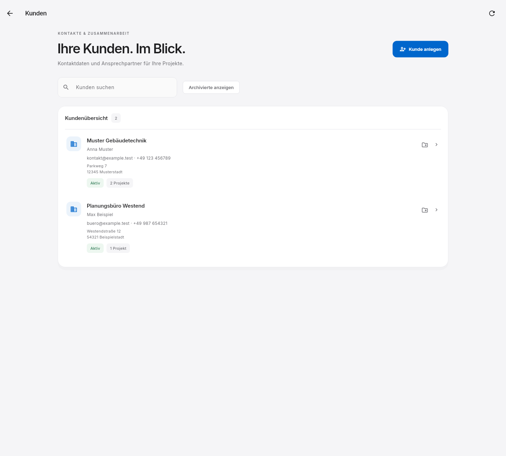
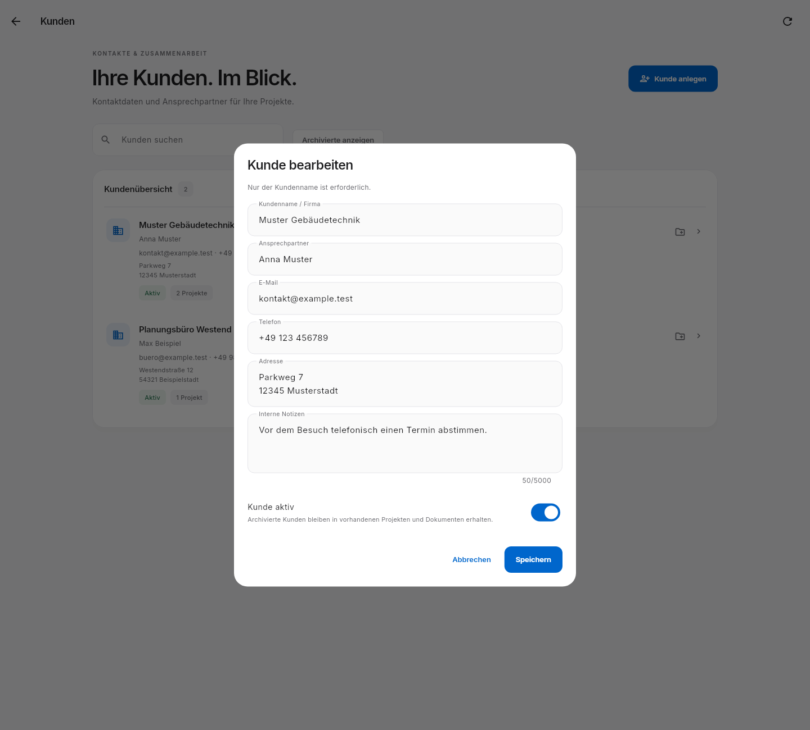

# Smartplan Office 0.4.0 – Kundenverwaltung

Diese Stufe läuft auf dem vorhandenen Windows-PC und verwendet dieselbe lokale
Python-Umgebung. Sie benötigt weder ein Hosting-Abonnement noch neue Python-Pakete.
Sie setzt die Entscheidung des Nutzers um, zunächst keine laufenden Hostingkosten
einzuplanen. Gemeinsamer Onlinebetrieb und eine installierte iPhone-App bleiben offen.

Die folgenden Ansichten stammen aus der tatsächlichen Oberfläche mit fiktiven
Testdaten. Diese Beispielkontakte werden nicht in die Nutzerdaten übernommen.

## Bedienung

Die Geschäftsführung öffnet **Kunden** in der Seitenleiste. Dort lassen sich
Kunden anlegen und bearbeiten: Name/Firma, ein Hauptansprechpartner, E-Mail,
Telefon, Adresse und interne Notizen. Nur der Name ist erforderlich.
Die Suche berücksichtigt Name, Ansprechpartner, E-Mail, Telefon und Adresse.
Der Projektzähler zeigt die tatsächlich verknüpften Projekte.

Über **Kunde aktiv** kann ein Kunde archiviert oder reaktiviert werden.
Archivierte Kontakte lassen sich mit **Archivierte anzeigen** wieder einblenden.
Ihre bestehenden Projekte und Dokumente bleiben erhalten. Neue Zuordnungen
erfordern einen aktiven Kunden. Eine Löschfunktion wird in dieser Stufe nicht angeboten.

Das Ordnersymbol am Kunden legt ein Projekt mit vorausgewähltem Kunden an.
Im normalen Projektdialog kann ein vorhandener Kunde gewählt oder ein neuer
Kundenname eingegeben werden. Letzteres legt den Kunden zugleich an.
In bestehenden Projekten öffnet das Kontaktsymbol **Kunden zuordnen** die Änderung
der Zuordnung. Bei gleichnamigen Kunden wird auch die Adresse im Auswahltext gezeigt.

Gleicher normalisierter Name und gleiche normalisierte Adresse werden als
Doppelanlage abgewiesen; ein gleicher Name an einer anderen Adresse ist erlaubt.
Unicode-Schreibweisen, Groß-/Kleinschreibung und zusätzliche Leerzeichen werden
beim Vergleich vereinheitlicht. E-Mail-Adressen werden syntaktisch geprüft.
Beim fehlgeschlagenen Speichern wird das ausgefüllte Formular wieder angezeigt.

## Rechte und Dokumente

Das vollständige Kundenverzeichnis mit Kontaktdaten und internen Notizen steht
in dieser ersten Stufe ausschließlich der Geschäftsführung zur Verfügung.
Andere Rollen behalten ihren bisherigen Zugriff auf explizit zugewiesene
Projekte und deren Kundennamen. Die API prüft diese Grenze unabhängig von der
Seitenleiste. Feingranulare CRM-Rechte und mehrere Ansprechpartner pro Kunde
sind spätere Erweiterungen.

Eine Änderung des Kundennamens aktualisiert die verknüpften Projektstammdaten
und gilt für neu erstellte Berichte. Bereits vorhandene Dokumente enthalten
weiterhin ihre damalige Momentaufnahme. Ihre Dokumentinhalte, Inhalts-Hashes,
Signaturen und gespeicherten PDF-Bytes werden nicht geändert.

## Update und Datenübernahme

1. App und bisherigen Starter schließen; einen manuell gestarteten alten Server beenden.
2. Das vollständige neue Artefakt **Smartplan-Office-Windows** aus dem erfolgreichen
   GitHub-Actions-Lauf herunterladen und in einen neuen Ordner entpacken.
3. Dort **Starten.cmd** öffnen. Es verwendet den gespeicherten Datenordner,
   erstellt die Sicherung vor dem Start und startet den neuen beiliegenden Server.
4. Als Geschäftsführung anmelden und **Kunden** öffnen.

Der Server erweitert das bisherige SQLite-Schema additiv auf Version 1:
Kundentabelle und Kundenzuordnung am Projekt. Die vorhandenen Projektkunden werden
nach normalisiertem Namen zusammengeführt und verknüpft. Kundennamen in den alten
Projekten und Dokumenten werden bei der Übernahme nicht umgeschrieben.
Es werden keine Kontaktdaten, Adressen oder Notizen erfunden. Die Übernahme
läuft in einer Transaktion und erfolgt pro Datenbank nur einmal. Bei einem Fehler
wird auch die Schemaänderung zurückgenommen.

Die zuvor vorhandenen Konten, IDs, Projektzuweisungen, Sitzungen, Berichte und
PDF-Dateien bleiben erhalten. Der Starter prüft beide unterstützten Schemata
und weist unvollständige oder zu neue Datenbanken ab. Die bisherige automatische
und manuelle Sicherung funktioniert weiter. Eine alte Sicherung erhält ihre
Kundenstruktur bei ihrem ersten Start mit der neuen Version.

Das vollständige Update wird benötigt: Die neue EXE benötigt die neuen
Kunden-API-Funktionen. Alte Quellordner/Serverprogramme sollten nicht mit der
erweiterten Arbeitsdatenbank gestartet werden. Eine gewünschte Rückkehr auf den
alten Stand erfolgt über eine **getrennt** wiederhergestellte Sicherung vor dem
Update; eine automatische Schema-Rückkonvertierung gibt es nicht.

## Prüfung

Die Backend-Suite umfasst 32 Fälle; auf Linux wird nur der Windows-spezifische
Jobobjekt-Test übersprungen. Neue Prüfungen betreffen Kundenerstellung,
Validierung, Dubletten, Archivierung, Zuordnung, Rollen und falsche HTTP-Methoden,
die wiederholbare Migration aus dem alten Schema und deren vollständigen Rollback.
Sicherung/Wiederherstellung erhält Kundendaten, Projektverknüpfungen und identische
signierte PDF-Bytes; alte Sitzungen bleiben bei einer Wiederherstellung gesperrt.

Die 23 App-Tests enthalten fünf neue Kunden-Bedienungsfälle sowie die erweiterte
Integration gegen einen echten Python-Server. Geprüft werden Suche, Bearbeitung,
Archivierung/Reaktivierung, Fehlermeldungen mit erhaltenem Formular, Projektanlage
und Zuordnung sowie ein schmales Fenster. Die tatsächliche Windows-Nutzerabnahme
der neuen Kundenverwaltung steht nach dem Build noch aus.

Dies ist die erste Kundenstufe. Anfragen, Aktivitätenverlauf, Angebote,
Kundenimport und mehrere Ansprechpartner sind noch nicht enthalten.
