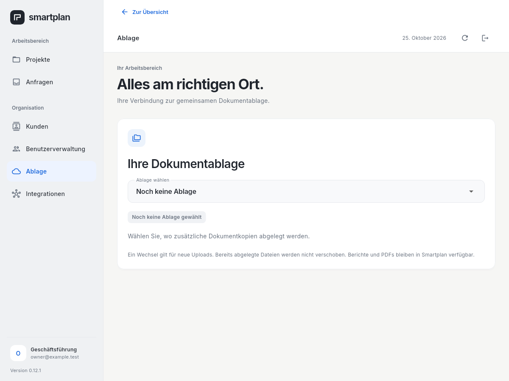
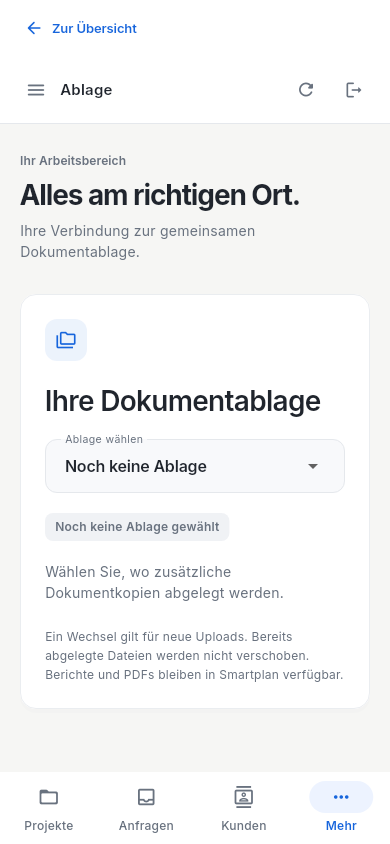

# App-Update 0.12.1: Rückweg aus der Verwaltung

Der native Client wird auf **0.12.1+121** angehoben. Die Verwaltung mit Projekten, Anfragen, Kunden, Benutzerverwaltung, Ablage und Integrationen bleibt erreichbar. Von dieser unter „Weitere Verwaltung“ geöffneten Ansicht führt die sichtbare Aktion **„Zur Übersicht“** in den zuvor geöffneten Hauptbereich zurück.

## Verhalten

Der Rückweg ist auf Desktop und Mobilgeräten als beschriftete Aktion sichtbar. Er schließt die Verwaltungsroute, ohne eine zweite Hauptansicht anzulegen. Ausgewählter Hauptbereich und vorhandene Filter bleiben erhalten; eine erneute Anmeldung wird dadurch nicht ausgelöst. Eigenständige Starts ohne Business-Hauptbereich erhalten keine Rückaktion ins Leere. Auch schnelle Mehrfachbetätigung erhält den ursprünglichen Hauptbereich. Sitzungsende und Abmeldung verwenden weiterhin den bestehenden geschützten Rückweg zur Anmeldung.

## Abnahme

Die Regression beginnt am tatsächlichen `OfficeApp`-Einstieg mit einer synthetischen V1-API: Anmeldung, Bereichswahl, Wechsel zur Verwaltung, Ablage und zweimaliger Rückweg. Desktop und 390px-Mobilansicht werden vom Login an geprüft; die Navigation bei 320px wird nach erfolgreicher Anmeldung mit 1,5-facher Schriftgröße geprüft. Zusätzlich sind ein reiner Legacy-Start einschließlich Drawer und ein Sitzungsende während des Verwaltungswegs abgedeckt. Die neue Regression reproduzierte den fehlenden Rückweg vor der Produktkorrektur.

Konkrete Test- und Paketnachweise stehen im [Navigations-PR](https://github.com/smartplanhofmann-spec/Smarplan-Hofmann-Workspace/pull/7). Lokale Abnahme: sechs neue Navigation-/Fallback-/Mehrfachbetätigungs-/Sitzungsfälle und acht bestehende Shell-/Legacyfälle, zusammen 14 gezielte Tests, sind grün. Der vollständige App-Lauf mit 313 Fällen, 14 Paketprüfungen und der Analyzer sind grün. Die 116 Gmail-Verträge waren vor und nach der Produktänderung grün. Der neue Client benötigt keine zusätzliche Serverfunktion.

## Windows aktualisieren

1. Das vollständig geprüfte Paket **Smartplan-Office-Windows-Online-Pilot** für 0.12.1 herunterladen.
2. Die bisherige App vollständig schließen und das gesamte ZIP in einen neuen Ordner entpacken. Die Windows-Appdaten und ihre verschlüsselten Warteschlangen erhalten; keine Deinstallation oder Datenlöschung durchführen.
3. `smartplan_office.exe` aus dem neuen Ordner starten. Die sichtbare Version muss 0.12.1 sein.
4. „Weitere Verwaltung“ öffnen und „Zur Übersicht“ prüfen.

Der vorhandene Serverstand `0.12.0-online-pilot`, Schema 7, bleibt passend. Die Server-Archivkorrektur aus [PR #6](https://github.com/smartplanhofmann-spec/Smarplan-Hofmann-Workspace/pull/6) bleibt enthalten. API v1, Konten, Gmail-Eingang und Backend-/Browser-Laufzeitquellen erhalten ihren Vertrag. Es gibt keine neue Datenbankmigration. Windows-Signierung und reale Mobilgeräteabnahme bleiben gesonderte Aufgaben.

## Gerenderte Oberfläche

