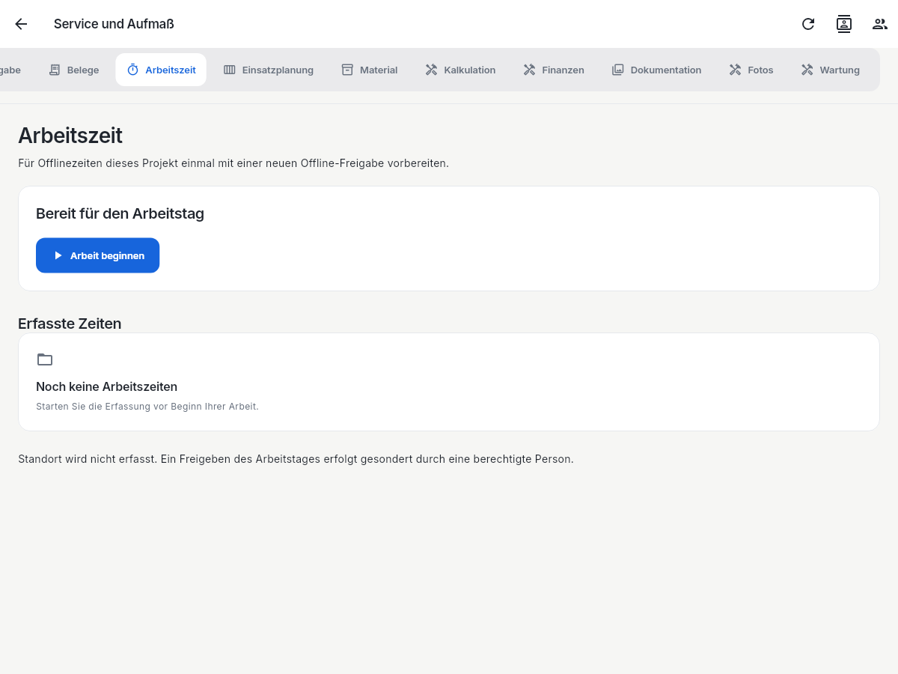
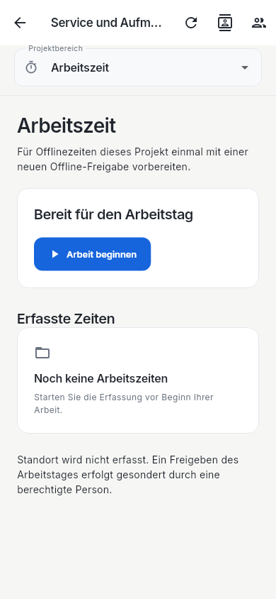

# Funktions- und Rückwegprüfung 0.12.2

Anlass: Beim Öffnen mehrerer Fachregister einer Projektmappe erschien eine graue Fläche ohne nutzbaren Rückweg. Geprüft wird der vorhandene Funktionsumfang, einschließlich leerer Listen, Ladefehler, geänderter Rechte, Dialogabbruch und ungesicherter Planarbeit. Die bestehende Hauptnavigation bleibt erhalten.

## Prüfumfang und Nachweise

Die neuen Tests öffnen die tatsächlichen App- und Projektrouten. Ihre synthetischen API-Fixtures liefern ausdrücklich definierte Antworten; unbekannte Aufrufe und unerwartete Schreibvorgänge schlagen fehl. Die Prüfung eines Registers verlangt sichtbaren fachlichen Inhalt, nicht lediglich das Ausbleiben einer Ausnahme.

| Bereich | Geprüfter Weg | Automatischer Nachweis |
|---|---|---|
| Anmeldung, Übersicht, Hauptnavigation | Anmeldung → alle neun Hauptbereiche → erneutes Öffnen; Desktop und 390px; Abmeldung → Anmeldung | `business_home_navigation_audit_test.dart`, `business_shell_widget_test.dart` |
| Anfragen und Anhänge | Anfrage öffnen/erfassen/übernehmen, Vorschau, Fehler und Rückkehr; Gmail-Body, Auth, Duplikate, Originalanhänge bleiben erhalten | `inquiry_widget_test.dart`, `mail_attachment_*test.dart`; die unveränderte 116-Fälle-Gmail-Gruppe vor und nach Änderungen |
| Integration und weitere Verwaltung | Hauptbereich → Anfragen/Integrationen/Verwaltung → bestehender Hauptbereich; Einstellungen mit vier Unterseiten und Dialogabbruch | `business_home_navigation_audit_test.dart`, `workspace_return_navigation_test.dart`, `integration_widget_test.dart` |
| Alle 17 Projektregister | Projektliste → Projekt → jedes sichtbare Register → Übersicht → erneut öffnen → Projektliste; Desktop und 390px | `project_business_tabs_navigation_test.dart` |
| Projektregister bei Störungen | Ausstehende Antwort, Ladefehler, Wiederholung, Rechteentzug, veralteter Register-Callback; erlaubte Arbeitszeit bleibt ausgewählt | `project_business_tabs_navigation_test.dart` |
| Aufgaben, Termine, Bautagebuch, Dokumentlinks | Erstellen, Bearbeiten und Abbrechen; Version-/Konflikt-/Scopegrenzen; Rückweg | `project_workspace_widget_test.dart`, `business_workflows_widget_test.dart`, Workspace-HTTP-Tests |
| CRM | Kontakte anzeigen, bearbeiten, Abbrechen, Ladefehler → Aktualisieren → Rückkehr; Datenübernahme in Belege | `business_home_navigation_audit_test.dart`, `business_workflows_widget_test.dart`, `test_business_contact_snapshot.py`, Completion-PG-Tests |
| Arbeitszeit und Personal | Start → Pause → Weiter → Ende; Personal-Unterbereiche und Editorabbruch; Offline-Neustart, Wiederholung nach verlorenem ACK | `project_business_tabs_navigation_test.dart`, `business_time_widget_test.dart`, `business_offline_time_test.dart`, Planungs-/Zeit-API-Tests |
| Planung und Ressourcen | Planungsansichten, Terminverschieben, Konflikte und Kalenderabgleich; Haupt-/Projektkontext | `business_planning_widget_test.dart`, `business_document_completion_test.dart`, Planungs-/Zeit-PG-Tests |
| Belege, Positionen und Storno | Editor öffnen/abbrechen, bestehende Stornogutschrift bearbeiten, erlaubte Typen; Rechteverlust während Dialog/Bestätigung; finale Belege geschützt | `financial_dialog_navigation_test.dart`, `business_documents_widget_test.dart`, `business_document_completion_test.dart`, Beleg-/E-Rechnungs-Fachtests |
| Finanzen und Unterlagenfreigabe | Zahlung und Storno abbrechen, Freigaben prüfen; erfolgreiches Neuladen entfernt alte Fehler; Entzug von Lese-/Schreibrechten | `financial_dialog_navigation_test.dart`, `business_finance_widget_test.dart`, `business_document_access_widget_test.dart` |
| Material und Kalkulation | Alle globalen Unterbereiche bleiben wechselbar; Entnahme/Rückgabe/Umlagerung mit passenden Feldern; Artikelwahl ohne Finanzrecht; Fehler und Abbruch | `business_home_navigation_audit_test.dart`, `feature_actions_navigation_test.dart`, Inventar-Fachtests und neue Artikelreferenz-HTTP-/PG-Tests |
| Wartung und Dokumentation | Abschluss-/Berichtsvorabruf mit sichtbarem Fehler statt verlorener Navigation; bestehende Fachabläufe | `feature_actions_navigation_test.dart`, Operations-/Wartungs-Fach- und HTTP-Tests |
| Fotos | Kamera-/Notizweg, verschlüsselte Speicherung vor Bestätigung, Neustart und Queue-Erhalt | `business_media_widget_test.dart`, `business_offline_media_test.dart` |
| Pläne und Importe | Planliste, Import, Quellen und Löschung; ungesicherter Plan → anderes Register → Projekt zurück; laufende lokale Speicherung und Import-Rücksprung | `project_unsaved_return_test.dart`, `plan_import_widget_test.dart`, `offline_plan_widget_test.dart`, Offline-/Import-Backend-Tests |
| Einstellungen | Vier Unterseiten, Vorlagen-/Artikel-/Rollen- und weitere vorhandene Editoren → Abbrechen → ursprüngliche Hauptansicht | `business_home_navigation_audit_test.dart`, bestehende Fachtests |

Die Dart-Dateien liegen unter `app/test/`; serverseitige Nachweise unter `backend/`, `backend/online/` und `backend/business_tests/`. Der gemeinsame lokale Gesamtlauf ist grün: **386 App-Tests**, darunter **73 neue Fälle** (8 Projektregister-, 9 globale Navigations-, 9 Plan-Rückweg-, 9 Aktions-/Dialog- und 38 Finanzdialogfälle). Der vollständige Analyzer meldet keine Befunde; drei zusätzliche echte native PDF-Rendererfälle sind grün. Zusätzlich sind 363 Backendfälle (eine vorgesehene plattformspezifische Auslassung), 95 Fach-/SMTP-/E-Rechnungsfälle, fünf echte PostgreSQL-Journey-/Completion-/Artikelreferenzfälle, 14 Paketprüfungen sowie 60 isolierte Operator- und zwei reale Git-Archivprüfungen grün. Die 116 Gmail-Verträge waren vor der ersten Produktänderung und nach dem vollständigen Patch grün. Diese Gruppen überlappen teilweise und werden nicht als Summe einzigartiger Tests ausgegeben. Die finalen CI-Ergebnisse stehen im Update-PR und im [Umsetzungsbericht](BERICHT_HERO_UMSETZUNG.md).

## Korrigierte Ursachen

- Die sieben bestehenden Projektregister wurden mit dem Index eines neueren Fachregisters angesprochen. Ein Bereichsfehler brach dadurch den gesamten Projektaufbau einschließlich App-Leiste ab. Die Überschriften werden jetzt aus dem jeweiligen Inhalt bestimmt.
- Fachregister werden über ihre Identität erhalten. Werden Rechte für ein früheres Register entzogen, wechseln erlaubte Register nicht auf einen anderen Inhalt; alte Klick-/Dropdown-Callbacks können keine ungültigen Indizes öffnen. Der mobile Wähler erhält eine begrenzte Breite.
- Projektgebundene Material-Unterbereiche lassen die Bereichsauswahl auch ohne ausgewähltes Projekt sichtbar. Lagerbuchungen unterscheiden die zulässigen Angaben je Bewegungsart; Rückgaben beziehen sich auf die ursprüngliche Entnahme.
- Finanzdialoge beobachten aktuelle Rechte. Bestehende Belegtypen bleiben darstellbar; eine Stornogutschrift entsteht aus ihrer Rechnung und lässt nur die kanonisch erlaubten Metadaten bearbeiten. Originalempfänger, Positionen und Beträge bleiben gebunden. Projektbezogene offene Posten hängen nicht mehr vom globalen Versandjournal ab. Erfolgreiche Wiederholungen entfernen alte Fehlermeldungen.
- Ungesicherte Planarbeit wird auch beim äußeren Projekt-Rückweg und vor einem Austausch des Plan-Navigators berücksichtigt. Eine laufende lokale Speicherung darf nicht durch Verlassen des Projekts abgebrochen werden.

## Ergänzende Lager-API und Kompatibilität

`GET /api/v1/business/inventory/articles` ergänzt einen begrenzten Artikelwähler. Die Antwort enthält ausschließlich `id`, `revision`, `code`, `name`, `unit`, `active`, dazu `has_more` und `next_after`. Die Seitengröße beträgt standardmäßig 100, höchstens 200; der Cursor ist eine validierte Artikel-ID. Nur aktive physische Artikel erscheinen. Preise, Stücklisten, Lieferanten und private Zusatzfelder bleiben ausgeschlossen.

`inventory_article_refs` ist ein zusätzliches Feature-Merkmal, kein Recht. Globale beziehungsweise aktuelle projektbezogene Lagerleserechte, Projektzuweisung und ausdrückliche Verbote bleiben verbindlich. Der bestehende finanzgeschützte `/articles`-Katalog wird nicht geöffnet. Ein älterer Server wird ausdrücklich erkannt; ein abgewiesener Zugriff wird nicht durch einen schwächeren Ersatzaufruf umgangen.

Die Lagerortverwaltung behält ihre vorhandene globale Lagerleseberechtigung. Ein ausschließlich projektbezogenes Artikel-Leserecht ersetzt diese Berechtigung nicht. Die vorhandene Technikerrolle besitzt das globale Lagerleserecht; zusätzliche Finanzrechte werden für die sichere Artikelwahl nicht benötigt.

API v1, Gmail/SPIN und Projektbot/SPIX behalten ihre Verträge. Das physische Schema bleibt 7; es gibt keine neue Migration und keine Datenlöschung. Server und Client heißen für dieses Paket 0.12.2. Sevdesk bleibt führender Aussteller; der Patch aktiviert weder Rechnungsversand noch externe Anbieter.

## Grenzen der Abnahme

Die Navigation aller vorhandenen Bereiche wird mit den bestehenden Fach-, HTTP-, Offline- und neuen Rückwegtests verbunden. Das bedeutet keine vollständige HERO-Parität und keine Behauptung, jede mögliche Eingabekombination geprüft zu haben. Der Bewertungsstand von 98 Anforderungen bleibt unverändert.

Echte Windows-/iPad-Bedienung, Kamera-/Geräteentsperrung, Anbieterzugänge, produktive E-Mail-Zustellung, Lieferantenprotokolle sowie rechtliche und steuerliche Freigaben bleiben gesonderte Betriebsabnahmen. Die Tests verwenden synthetische Daten; eine erfolgreiche Cloudprüfung bestätigt keine bereits ausgeführte Hetzner-Installation. Die unveränderte, geschützte Installation und die Paketwahl beschreibt [App-Update 0.12.2](APP_UPDATE_0_12_2.md).

## Gerenderter Arbeitszeitbereich

