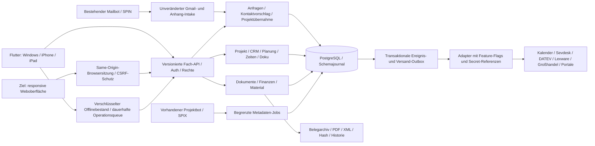

# Zielarchitektur: projektzentriertes Smartplan Office

Die Zielarchitektur bleibt die ursprüngliche Planungsgrundlage. Tatsächliche Umsetzung, Einschränkungen und Abnahmen stehen in [BERICHT_HERO_UMSETZUNG.md](BERICHT_HERO_UMSETZUNG.md).

Stand: **25.10.2026**. Analysebasis: Commit `f2e729486edc2652f466e21c30d25b6e710b199f`, App 0.11.0+15, Online-Schema 6. Dieses Dokument ist ein **Entwurf zur Freigabe in Phase 0**, keine bereits implementierte Architektur. Der Phase-0-PR verändert ausschließlich dieses Dokument und [GAP_ANALYSE_HERO.md](GAP_ANALYSE_HERO.md).

## 1. Ziel und verbindliche Grenzen

Das Projekt verbindet den gesamten Vorgang von Anfrage und Kontakt über Planung, Durchführung und Dokumentation bis zu Rechnung, Zahlung und Export. Es erhält eine eigene, ruhige Smartplan-Oberfläche; übernommen werden fachliche Abläufe und Informationsarchitektur, keine fremden Texte, Marken, Farben oder Assets.

Der neue Auftrag erweitert das Ziel ausdrücklich um eigene kaufmännische Funktionen. **Bis zum kontrollierten Umstieg bleibt Sevdesk im Betrieb führend.** Die vorhandene lesende Integration wird nicht unvermittelt zu einer schreibenden Verbindung. Eigene Rechnungsstellung entsteht zunächst deaktiviert und mit synthetischen Testdaten; ein dokumentierter Umstieg legt fest, welches System für welchen Betrieb, Zeitraum und Nummernkreis ausstellt. Eine Rechnung wird niemals gleichzeitig in zwei Systemen erzeugt.

Google Kalender und **OneDrive** verwenden im Bestand die Verbindungen des vorhandenen Bots. Der SPIN-Maileingang, sein Fünfminutenjob und seine Quittungen bleiben erhalten; die SPIX-Metadatenübergabe bleibt ein getrennter Berechtigungsbereich. Planoriginale und Erkennung bleiben auf Hetzner, ohne externe KI-/OCR-Ausweichdienste.

Projektstatus beschreiben den Arbeitsstand, erzwingen aber keinen starren Ablauf: Besichtigung, Aufmaß, Serviceeinsatz, Angebot, Anzahlung und Materialbestellung können unterschiedlich angeordnet sein. Zahlungs-, Material-, Dokument- und Ausführungsstatus werden getrennt geführt.

**Abwärtskompatibilität ist eine Freigabebedingung.** `/api/v1/intake/gmail`, bestehende Authentifizierung, Antwortformen, Wiederholungen und Anhangrouten bleiben erhalten. Vor Änderungen an diesen oder gemeinsam genutzten Komponenten werden zuerst die in der Gap-Analyse genannten Regressionstests ergänzt. Neue Anforderungen werden über zusätzliche Module und additive APIs eingeführt.

## 2. Architekturentscheidung

Der vorhandene Python-/Flask-Backendkern bleibt ein modularer Monolith mit PostgreSQL im gemeinsamen Betrieb. Bestehende SQLite-Domänen und native Flutter-Clients bleiben während der Erweiterung unterstützt. Eine gleichzeitige Neuentwicklung in einem anderen Backendframework oder eine Microservice-Aufteilung würde das Risiko unnötig erhöhen.

Fachmodule erhalten klar getrennte Anwendungsdienste, Transaktionen, Rechteprüfungen und Adapter. Neue Buchungs-, Zahlungs-, Lager- und Zeitdaten werden relational modelliert; das bestehende JSON-Modell wird nicht ungeprüft als universelles Finanzmodell verwendet. Bisherige IDs und Altbelege bleiben erhalten.

Ein fachliches Ereignis und der zugehörige Outbox-Eintrag werden in derselben Datenbanktransaktion angelegt. HTTP-Aufrufe, E-Mail-Versand, PDF-/XML-Verarbeitung und Providerzugriffe laufen nicht unter einer globalen Office-Sperre. Der bisherige globale PostgreSQL-Transaktionslock wird erst nach Race- und Isolationstests schrittweise durch passende Projekt-, Ressourcen- und Nummernkreissperren ersetzt.

## 3. Navigation und Bedienung

### Hauptnavigation im Web

| Bereich | Inhalt | Zugriff |
| --- | --- | --- |
| Übersicht | Unternehmensfeed, eigene Aufgaben, heutige Termine; finanzielle Kennzahlen nur mit Recht | Nach Berechtigung gefiltert |
| Anfragen | Bestehender Eingang; Gmail, manuell/Telefon/WhatsApp, später Formular und Portale; Zuordnung statt ungeprüfter Dublettenanlage | Geschäftsführung/Projektleitung |
| Projekte | Suche, Liste und Pipeline; frei konfigurierbare Status | Zugewiesene Projekte, Geschäftsführung vollständig |
| Kontakte | Kunden, Lieferanten, Partner und Ansprechpartner | Nach Kontakt-/Projektfreigabe |
| Einsatzplanung | Kalender und Plantafel, Mitarbeiter, Ressourcen, Abwesenheiten | Rollen- und ressourcenbezogen |
| Dokumente | Projektübergreifende Belege und Berichte, Typ-/Status-/Projektfilter | Gleiche Fachrechte wie im Projekt |
| Finanzen | Rechnungen, OP, Zahlungen, Mahnläufe, Belege, Exporte | Gesonderte Finanzrechte |
| Material | Artikel, Leistungen, Lager, Bewegungen und Bestellungen | Gesonderte Lese-/Buchungsrechte |
| Personal | Mitarbeiter, Zeiten, Freigaben, Abwesenheiten, Arbeitszeitkonten | Eigene Daten oder Personalrecht |
| Einstellungen | Firma, Vorlagen, Nummernkreise, Rollen, Integrationen, Aufbewahrung | Administrative Rechte |

Nicht verfügbare Module werden klar als noch nicht freigeschaltet dargestellt oder ausgeblendet; leere Platzhalter gelten nicht als umgesetzte Funktion. Bestehende Einstiegspunkte bleiben über Übergangslinks erreichbar.

### Projektmappe

Die Übersicht zeigt Kunde und Objekt, Projektumfang, Verantwortliche, Status, nächste Aufgaben, Termine und sachlich berechtigte Kennzahlen. Darunter stehen folgende Register; auf kleinen Geräten als übersichtliches Menü statt einer gequetschten Zeile:

| Register | Verantwortlicher Datenbereich |
| --- | --- |
| Übersicht | Projektprofil, Status, Fortschritt, Meilensteine |
| Dokumente | Angebot, AB, Aufmaßbeleg, Lieferschein, Rechnung, Storno; typisierte Beziehungen |
| Termine | Projektereignisse und zugewiesene Einsätze |
| Aufgaben | Aufgaben, Checklisten, Zuständigkeiten, Fälligkeiten |
| Zeiten | Projektzeiten, Freigaben und abrechenbare Zuordnungen |
| Material | Bedarf, Reservierungen, Entnahmen, Bestellungen |
| Fotos & Dokumentation | Galerie, Bautagebuch, Berichte, Mängel, Pläne als Unterbereich |
| Logbuch | Fachereignisse, Notizen und Nachrichten mit eindeutiger Autorenschaft |
| Kalkulation | Angebot, Budget, Nachträge, Soll-Ist; eigenes Recht |

Dokumente im globalen Bereich und im Projekt sind dieselben Objekte. Inhalte werden nicht kopiert, nur um eine zweite Ansicht zu erzeugen. Die bestehenden Pläne und unterschriebenen Berichte bleiben direkt erreichbar.

### Mobil und Webfähigkeit

Das aktuelle Produkt ist eine native Flutter-App, keine bereits produktionsfähige PWA. Webfähigkeit erfordert zuerst Plattformadapter für Dateizugriff, sichere Ablage, PDF, Kamera und Synchronisation sowie einen CI-Webbuild und Browser-E2E-Tests. Android benötigt ein versioniertes Ziel, Kamera-/Dateifreigaben und echte Gerätetests. Ein iOS-Simulator oder unsignierter Gerätebuild belegt keine Android-/TestFlight-Verteilung.

Vorschlag: Flutter als gemeinsame UI weiterverwenden, vorhandene `dart:io`-Abhängigkeiten hinter Plattformadaptern abtrennen und den responsiven Webclient in Phase 1 gesondert freigeben. Bis dahin bleibt die native App nutzbar. Browserofflinefunktionen verwenden geprüfte IndexedDB-/WebCrypto-Adapter; native Dateivaults werden nicht durch unsicheren Browser-LocalStorage ersetzt. Weboffline wird erst nach Erfüllung derselben Daten- und Rechtekriterien aktiviert.

Native Clients behalten ihre bestehende Bearer-Anmeldung. Für das neue Same-Origin-Webziel wird eine zusätzliche kurzlebige `HttpOnly`-/`Secure`-/`SameSite`-Browsersitzung mit CSRF-Schutz vorgeschlagen. Das ersetzt weder SPIN/SPIX noch bestehende App-Token und bedarf eigener Auth-Regressions- und Browsertests.

Texte bleiben in der vorhandenen Sie-Form. Anzeige: `25.10.2026`, `1.234,50 €`, deutsche Mengen-/Prozentformate. API und Speicherung bleiben ISO-Datum, UTC-Zeitpunkt plus benötigte IANA-Zeitzone und exakte Dezimalwerte; lokalisierte Anzeigetexte werden nicht zurückgeparst. Fremde Beträge ohne bekannte Währung werden nicht als EUR ausgegeben. EUR ist die explizite Betriebswährung neuer eigener Belege.

## 4. Ziel-Datenmodell

### Kerneinheiten und Invarianten

Die Namen beschreiben das Ziel; sie sind keine bereits vorhandenen Tabellen. Die tatsächliche Tabellenliste steht in der Gap-Analyse.

| Einheit | Wesentliche Felder/Beziehungen und Invarianten |
| --- | --- |
| Company / CompanySettings | Eigene Betriebsidentität, Währung, Zeitzone, Branding und Regeln; zunächst dieser eine Betrieb, kein vorausgesetztes SaaS-Mandantenprodukt; Nummernkreise und Aussteller beziehen sich eindeutig darauf |
| Contact, ContactAddress, ContactPerson | Kunde/Lieferant/Partner; mehrere Adressen/Ansprechpartner; Legacy-Kunden-ID erhalten; Dubletten nur kontrolliert zusammenführen |
| Inquiry | Bestehende Anfrage mit Quelle, Fremd-ID, Kontaktdaten, Text und `project_id`; Gmail-Vertrag und ursprüngliche IDs erhalten |
| Project, ProjectStatus, ProjectMember | Projektnummer, Kontakt, Objektadresse, Beschreibung, Verantwortlicher, Status-/Pipelinekonfiguration; keine implizite Auftragszusage |
| Document, DocumentPosition, DocumentRelation | Typ, Status, Revision, Nummer, Finalisierungszeit, Hash; Positionen mit Menge/Einheit/EK/VK/Steuer/Lohn-/Materialanteil; explizite Umwandlungs- und Korrekturbeziehungen |
| DocumentArtifact, DocumentVersion | Original-PDF/XML, Inhalts- und Formatversion, Hash/Erzeugungszeit, Prüfbericht; finale Fassungen unveränderbar |
| Article, Service, ServiceComponent | Lieferant, Herkunft und Preisversion; Leistung aus Material, Lohn und Maschine; Kalkulationsstand im Beleg eingefroren |
| Appointment, AppointmentSeries | Projekt, Start/Ende, Zeitzone, Serienregel und Ausnahmen; Serienänderungen mit klarer Reichweite |
| AppointmentEmployee, AppointmentResource, Resource | Mitarbeiter-/Fahrzeug-/Maschinen-/Werkzeugbelegung; Verfügbarkeiten und Konfliktprüfung |
| Task, Checklist, ChecklistItem | Projekt, Zuständigkeit, Fälligkeit, Status, Vorlage; Übernahme in Servicebericht mit Herkunft |
| TimeEntry, TimeEvent, TimeCategory, TimeApproval | Mitarbeiter/Projekt, Start/Ende/Pause, Kategorie, Status, Revision und Herkunftsoperation; freigegebene Zeiten nur durch nachvollziehbare Korrektur ändern |
| TimeLocation | Höchstens eine optionale Koordinate pro Start-/Stoppereignis, getrennt gespeichert; eingeschränkte Rechte; nach Freigabe löschen, keine Bewegungsfolge |
| Employee, User, Role, Permission, Absence, Shift | Mitarbeiterprofil getrennt vom Login; konfigurierbare Rechte, Abwesenheiten/Freigaben, Dienst- und Arbeitszeitmodell |
| Media, FileObject, DiaryEntry, Defect | Projekt, Originalhash, Dateirevision, Beschriftung/Annotation, Aufnahme-/Uploadzeit, Mangelstatus; keine stille Änderung des Originals |
| LogEntry, Message | Projekt, Autor, Zeit, Ereignis-/Nachrichtentyp; bearbeitete Inhalte mit Historie; keine System- oder Kundenidentität vortäuschen |
| Payment, PaymentAllocation | Zahlungseingang und kontrollierte Zuordnung zu einer oder mehreren Rechnungen; keine reine Textmarkierung „bezahlt“ |
| InvoiceAllocation | Zuordnung von Abschlägen/Teilrechnungen/Schlussrechnung und bereits abgerechneten Mengen/Beträgen; verhindert doppelte Abrechnung |
| DunningLevel, DunningRun, DunningItem | Höchstens sechs Stufen, Vorlage/Intervall/Karenz; Vorschlag, Freigabe, Versandquittung und Fortschreibung getrennt |
| StockLocation, StockMovement, StockReservation | Nachvollziehbares Bewegungsjournal; Bestand aus gebuchten Bewegungen, keine unprotokollierte Summenänderung |
| PurchaseOrder, PurchaseOrderItem | Lieferant, Projekt, Positionen, Bestell-/Lieferstatus, explizite Versandfreigabe |
| Asset, MaintenanceContract, MaintenanceVisit | Anlage, Vertrag/Intervall, nächste Fälligkeit, Serienplanung und abgeschlossene Wartungshistorie |
| Template, TextBlock, CompanySettings | Eigene Gestaltung und versionierte Vorlagen; finaler Beleg verweist auf tatsächlich verwendete Fassung |
| NumberRange | Betrieb, Belegart, Zeitraum, Präfix und transaktionaler nächster Wert; keine Rücksetzung nach Ausstellung |
| AuditLog, OutboxEvent, OperationReceipt | Zugriff/Sicherheits- und Fachereignisse, externe Zustellung und Wiederholbarkeit; Audit ohne Schlüssel oder unnötige Klartextdaten |
| IntegrationConnection, ExternalReference | Adapter, freigegebener Umfang, Konfiguration ohne Geheimniswert, Secret-Referenz, externe ID und bestätigter Synchronisationsstand |
| SchemaMigration, PrivacyRequest, PrivacyTombstone | Checksumme/Kompatibilitätsstand; Export-/Löschauftrag und Wiederherstellungs-/Synchronisationsschutz |

`parent_document_id` allein genügt für kumulierte Rechnungen, mehrere Abschläge und Korrekturen nicht. Typisierte Dokumentbeziehungen und Betrags-/Mengenallokationen sichern diese Fälle. Finanzielle Inhalte verwenden `Decimal`/Datenbank-`NUMERIC` mit dokumentierter Rundungsregel, keine binären Gleitkommazahlen. Der finale Beleg enthält einen eigenen unveränderlichen Adress-, Preis-, Steuer- und Vorlagensnapshot; spätere Stammdatenänderungen verändern ihn nicht.

### ER-Übersicht

```mermaid
erDiagram
  COMPANY ||--o{ NUMBER_RANGE : definiert
  COMPANY ||--o{ DOCUMENT : stellt_aus
  CONTACT ||--o{ CONTACT_ADDRESS : besitzt
  CONTACT ||--o{ CONTACT_PERSON : hat
  CONTACT ||--o{ PROJECT : beauftragt
  INQUIRY }o--o| CONTACT : zugeordnet
  INQUIRY }o--o| PROJECT : uebernommen
  INQUIRY ||--o{ FILE_OBJECT : anhaenge
  PROJECT ||--o{ PROJECT_MEMBER : berechtigt
  USER ||--o{ PROJECT_MEMBER : ist
  PROJECT_STATUS ||--o{ PROJECT : klassifiziert
  PROJECT ||--o{ DOCUMENT : enthaelt
  DOCUMENT ||--o{ DOCUMENT_POSITION : gliedert
  DOCUMENT ||--o{ DOCUMENT_ARTIFACT : archiviert
  DOCUMENT ||--o{ DOCUMENT_RELATION : verknuepft
  NUMBER_RANGE ||--o{ DOCUMENT : nummeriert
  ARTICLE o|--o{ DOCUMENT_POSITION : referenziert
  SERVICE ||--o{ SERVICE_COMPONENT : besteht_aus
  PROJECT ||--o{ APPOINTMENT : plant
  APPOINTMENT ||--o{ APPOINTMENT_EMPLOYEE : besetzt
  EMPLOYEE ||--o{ APPOINTMENT_EMPLOYEE : arbeitet
  APPOINTMENT ||--o{ APPOINTMENT_RESOURCE : belegt
  RESOURCE ||--o{ APPOINTMENT_RESOURCE : dient
  EMPLOYEE ||--o{ ABSENCE : beantragt
  EMPLOYEE ||--o{ TIME_ENTRY : erfasst
  PROJECT ||--o{ TIME_ENTRY : erhaelt
  TIME_ENTRY ||--o{ TIME_EVENT : protokolliert
  TIME_ENTRY ||--o{ TIME_LOCATION : optional
  PROJECT ||--o{ TASK : umfasst
  TASK ||--o{ CHECKLIST_ITEM : prueft
  PROJECT ||--o{ MEDIA : dokumentiert
  PROJECT ||--o{ DIARY_ENTRY : berichtet
  PROJECT ||--o{ DEFECT : verfolgt
  PROJECT ||--o{ LOG_ENTRY : protokolliert
  PROJECT ||--o{ MESSAGE : kommuniziert
  PAYMENT ||--o{ PAYMENT_ALLOCATION : verteilt
  DOCUMENT ||--o{ PAYMENT_ALLOCATION : beglichen
  DUNNING_RUN ||--o{ DUNNING_ITEM : schlaegt_vor
  DOCUMENT ||--o{ DUNNING_ITEM : erinnert
  STOCK_LOCATION ||--o{ STOCK_MOVEMENT : verbucht
  ARTICLE ||--o{ STOCK_MOVEMENT : bewegt
  PURCHASE_ORDER ||--o{ PURCHASE_ORDER_ITEM : bestellt
  ASSET ||--o{ MAINTENANCE_CONTRACT : betreut
  MAINTENANCE_CONTRACT ||--o{ MAINTENANCE_VISIT : dokumentiert
```

## 5. Rechte und Audit

Bestehende Rollen bleiben bei der Migration erhalten. Neue Berechtigungen werden zusätzlich eingeführt, nicht aus einer sichtbaren Registerkarte abgeleitet. Geschäftsführung kann Rechte vergeben; ein Entzug wirkt serverseitig bei jeder Operation und vor dem Commit nach externem I/O.

| Fachrecht | Geschäftsführung | Projektleitung | Technik | Buchhaltung |
| --- | --- | --- | --- | --- |
| Zugewiesene Projekte/Unterlagen | Alle | Zugewiesen | Zugewiesen | Zugewiesen oder explizite Finanzfreigabe |
| Anfrage bearbeiten/übernehmen | Ja | Ja | Nein als Standard | Nein als Standard |
| Kontaktstammdaten ändern | Ja | Zugewiesener Umfang | Nur explizit erlaubte Felder | Nach Freigabe |
| Aufgaben/Doku | Ja | Zugewiesen | Zugewiesen | Lesen nach Freigabe |
| Eigene Zeiten | Ja | Ja | Ja | Ja |
| Fremde Zeiten freigeben/Personal | Eigenes Personalrecht | Nur mit Personalrecht | Nein | Nur mit Personalrecht |
| Angebote/Preise/Kalkulation | Ja | Nur mit kaufmännischem Recht | Nein als Standard | Nach Freigabe |
| Rechnungen/OP/Mahnung/Zahlungen | Ja | Nur mit Finanzrecht | Nein | Ja, freigegebener Umfang |
| Ausgabe finalisieren/Versand freigeben | Eigenes Ausstell-/Versandrecht | Nur explizit | Nein | Nur explizit |
| Kontakt löschen/exportieren | Separates Datenschutzrecht | Nein als Standard | Nein | Nein als Standard |
| Integrationen/Secrets/Nummernkreise | Eigenes Administrationsrecht | Nein | Nein | Kein automatischer Secretzugriff |

Die Tabelle ist ein Zielstandard, nicht die heutige vollständige Implementierung. Serverseitige Filter gelten für Listen, Suchtreffer, Feed, SSE, Exporte, Anhänge und Einzelabrufe. Ein Nutzer ohne Finanzrecht erhält keine Rechnungspayloads, Summen, Vorschautexte oder entsprechenden Auditdetails. Projektfreigabe allein gewährt kein Finanzrecht. Im Bestand sind manuelle Angebots-/Rechnungslinks und konvertierte Mailoriginale allgemeiner projektlesbar als das Sevdesk-Panel. Phase 1 führt deshalb eine serverseitige Dokument-/Anhangsklassifikation samt sicherer Freigabe unbekannter Altinhalte ein. Finanz-/Personaldateien dürfen nicht über generische Links, Vorschau, Suchindex oder Originaldownload an diesen Rechten vorbeigehen. Eine strengere Sichtbarkeit bestehender Inhalte wird als Berechtigungsmigration mit Hinweis, Zugriffstest und nachvollziehbarer Freigabe im Teil-PR dokumentiert.

Audit erfasst insbesondere Rollenänderung, Export/Löschung, Finalisierung/Storno, Nummernkreisänderung, Zeitfreigabe, manuellen Konfliktentscheid, Mahnlauffreigabe und Integrationseinrichtung. Protokolliert werden Akteur-ID, Aktion, Objekt-ID, Zeitpunkt, Request-/Korrelation-ID und erforderlicher Änderungsnachweis. Geheimnisse, Standortwerte und vollständige Mailtexte gehören nicht ins allgemeine Audit. Auditdaten erhalten eigene Zugriffs- und Aufbewahrungsregeln sowie Manipulationsschutz; ein vorhandener Hash allein ist keine Revisionssicherheit. Die heutige Dienstrolle ist Datenbankeigentümer. Im Ziel werden Migrations-/DDL-Rolle und Laufzeitrolle getrennt; die Laufzeitrolle kann finale Belege und Audit weder ändern/löschen noch deren Schutzregeln aufheben.

## 6. Anfrage, Projekt und kompatible API

Der bestehende Intake bleibt der stabile Eingang. Neue Webformulare und Portale adaptieren ihre Daten auf denselben Anfrage-Anwendungsdienst, ohne fremde Eingaben zu vertrauen oder Gmail-Credentials für allgemeine Fachzugriffe zu verwenden.

Die bestätigte Aktion „In Projekt übernehmen“ verknüpft Anfrage, vorhandenen oder neuen Kontakt, Projekt und Anhangsicht in einer Transaktion. Wiederholungen mit derselben Operations-ID erzeugen keine Dubletten. Übereinstimmende E-Mail oder Telefonnummer ist ein Kontaktvorschlag, keine Erlaubnis zum Überschreiben oder Zusammenführen. Vorhandene Gmail-/Anfrage-/Projekt-/Anhang-IDs und externe Quittungen bleiben gültig.

Neue Routen werden additiv unter `/api/v1` eingeführt. Der genaue Vertrag wird im jeweiligen Teil-PR festgeschrieben; die bestehenden Intake-Routen werden nicht für neue Zwecke umgedeutet. Unvermeidbare Inkompatibilität erfordert einen eigenen `BREAKING`-Abschnitt, Migrationspfad und Parallelbetrieb statt stiller Feldumbenennung.

Automatische Websiteantworten benötigen eine konfigurierte, freigeschaltete Vorlage, einen passenden Versandadapter und eine gegen Wiederholungen geschützte Zustellung. Das Anlegen einer Anfrage gilt nicht als Zustimmung zu Werbung. Portal- oder Telefonkanäle lösen vor ihrer expliziten Freigabe keinen automatischen Versand aus.

## 7. Eigene Belege, Festschreibung und Zahlungen

### Dokumentfluss

Angebot → AB → Rechnung sind Umwandlungen mit Herkunftsverweis und eingefrorenen Kontakt-, Positions-, Preis- und Steuerwerten. Neue Dokumente erhalten eigene IDs; eine angenommene Angebotsfassung wird nicht nachträglich überschrieben. Abschläge, Schluss- und kumulierte Rechnungen berücksichtigen Allokationen, Stornos und bereits berechnete Beträge. Zeiten oder Aufmaßwerte können nachvollziehbar in Positionen übernommen werden, ohne die Herkunft zu verlieren oder dieselbe Leistung doppelt abzurechnen.

### Festschreibung und Nummern

- Entwürfe haben eine interne ID und Revision; die endgültige Rechnungsnummer entsteht erst beim erfolgreichen Finalisieren.
- Ein Nummernkreis wird transaktional gesperrt. **Keine PostgreSQL-Sequenz** für die zugesagte lückenlose Ausgabenummer: Rollbacks verbrauchen dort sonst Nummern.
- Nummernfortschreibung, finale Rechnungsdaten, unveränderliche PDF-/XML-Artefakte, Hash, Zeitstempel und Finalisierungsquittung werden atomar festgeschrieben. Für finale Artefakte ist zunächst transaktionale Datenbankablage vorgesehen. Bestehende Mail-/Planoriginale bleiben in ihrer bisherigen Datenbankablage; eine andere Ablage großer Medien benötigt eine eigene erhaltende Migration.
- Scheitern Validierung, Berechtigung, Archivierung oder Commit, entsteht keine ausgestellte Nummer. Nach Commit liefert dieselbe Operations-ID denselben Beleg, auch nach einem Verbindungsabbruch.
- Nach Finalisierung sind Inhalte, Nummer und Artefakte nicht editierbar. Korrektur erfolgt durch einen verknüpften Storno-/Korrekturbeleg. Eine stornierte Rechnung bleibt Teil des Nummernkreises; ihre Nummer wird nicht wiederverwendet.
- Dateihash, Versionshistorie, unveränderliche Speicherrechte, Wiederherstellungstest und nachvollziehbarer Export werden gemeinsam benötigt. Eine Hashspalte oder einfache Zeichensignatur macht das heutige System nicht bereits GoBD-konform.

**Im späteren Festschreibungscode und in der Betriebsdokumentation muss ausdrücklich stehen:** Die technische Umsetzung ersetzt keine vom Betrieb und gegebenenfalls Steuerberater geprüfte GoBD-Verfahrensdokumentation, Aufbewahrung, Berechtigungskontrolle und laufende Betriebspraxis. Phase 0 erteilt keine rechtliche GoBD-/eIDAS-Zertifizierung. Für jede Dokumentart wird das benötigte eIDAS-Niveau vor Umsetzung ausdrücklich festgelegt: einfache, fortgeschrittene oder qualifizierte elektronische Signatur. Die heutigen Zeichenstriche werden nicht als fortgeschrittene oder qualifizierte Signatur ausgegeben.

XRechnung und ZUGFeRD erhalten Formatadapter mit festgehaltenen Spezifikations-/Validatorversionen, Profilen, Pflichtdaten und reproduzierbaren Validierungsberichten. Die XRechnung muss gegen den offiziellen Validator bestehen; gemockte XML-Erzeugung genügt nicht. XML-Eingang wird ohne externe Entityauflösung und mit Größen-/Zeitlimits verarbeitet. Upload, Datenerfassung und automatische Extraktion sind getrennte Fähigkeiten. GiroCode ist eine Zahlungsinformation, keine Zahlungsbestätigung.

### OP, Mahnung und Versand

Zahlungen und Teilzahlungen werden als nachvollziehbare Buchungen mit Allokationen geführt. Die OP-Ansicht berechnet offene Beträge und berücksichtigt Storno, Gutschrift/Korrektur und Zahlungen. Externe Zahlungsbestätigungen werden erst nach authentifizierter, idempotenter Prüfung übernommen.

Ein Mahnlauf speichert zuerst eine Vorschlagsliste mit höchstens sechs konfigurierten Stufen: drei Erinnerungen und drei Mahnungen, jeweils mit Name, E-Mail-Vorlage, Tagesintervall und Karenztag. Empfänger, Vorlagen, Beträge und Zuständigkeiten sind prüfbar. **Ohne manuelle Freigabe keine Sendung.** Änderungen nach der Freigabe erfordern eine neue Prüfung. Die freigegebene finale Mahnung, genau ein Stufenereignis und der Versand-Outboxeintrag werden atomar festgeschrieben. Vorschau, nicht freigegebener Entwurf und Retry erhöhen keine Stufe. Die Zustellquittung ist ein separater Zustand: Eine angelegte Mahnung wird erst nach bestätigtem Providerergebnis als versandt angezeigt. Bei ausstehendem, fehlgeschlagenem oder unklarem Versand wird derselbe freigegebene Vorgang geklärt; es entsteht weder eine zweite Mahnung noch die nächste Mahnstufe.

Externe Zustellung hat einen eigenen Status. Bei unklarer SMTP-Quittung wird nicht blind erneut gesendet: Zustand „Versand unklar“, Abgleich oder manueller Entscheid. Eine Outbox allein garantiert kein Exactly-once-Verhalten eines fremden Mailservers. Anbieter mit Idempotenzschlüsseln werden entsprechend genutzt; Freigabe, Versuch und tatsächliche Quittung bleiben getrennt nachvollziehbar.

## 8. Planung und Ereignisse

Termine, Mitarbeitereinsatz und Ressourcenbelegung verwenden ein gemeinsames kanonisches Terminobjekt. Plantafel und Mitarbeiterkalender zeigen denselben bestätigten Stand. Eine Änderung wird transaktional geschrieben und über einen berechtigungsgefilterten Ereignisstrom aktualisiert; bei Wiederverbindung wird anhand eines Cursors nachgeladen. Bis diese Technik implementiert und gemessen ist, bleibt der heutige Betrieb als Polling gekennzeichnet.

Zeiträume, Zeitzonen, Serienausnahmen, Abwesenheiten und konkurrierende Verschiebungen werden serverseitig geprüft. Doppelbelegungen werden angezeigt; bewusst erlaubte Übersteuerungen benötigen ein eigenes Recht und Audit. Ein bloßer Frontendvergleich verhindert keine Race Conditions. Offlineänderungen mit veralteter Revision erzeugen einen sichtbaren Konflikt.

Die sofortige Änderung im internen Mitarbeiterkalender ist das Phase-3-AK. Schreibender Google-Abgleich ist eine zusätzliche, standardmäßig deaktivierte Adapterfähigkeit mit eigener Freigabe und Fehlerbehandlung. Der vorhandene lesende Bot wird nicht als bereits vorhandene bidirektionale Kalenderintegration ausgegeben.

## 9. Zeiterfassung und Offline

Die Stempeluhr verwendet die Zustände Arbeiten, Pause und Beendet. Operationen besitzen stabile IDs und enthalten Gerät, Mitarbeiter, Projekt, Ereigniszeit, Empfangszeit, Reihenfolge und erwartete Revision. Die native verschlüsselte Outbox wird erweitert statt durch einen zweiten konkurrierenden Syncmechanismus ersetzt.

Beim Wiederverbinden bestätigt der Server jede Operation eindeutig. Identische Wiederholung bleibt ohne Duplikat; widersprüchliche Wiederholung wird abgelehnt. Gleichzeitiges Stempeln auf zwei Geräten oder überlappende Zeiten werden zur Klärung vorgelegt, nicht still zusammengerechnet. Freigegebene Zeiträume erhalten Korrekturereignisse statt nachträglicher verdeckter Änderung.

Dauer wird aus UTC-Zeitpunkten berechnet; Anzeige und Kalendertag berücksichtigen `Europe/Berlin` und Sommer-/Winterzeit. Pausen-/Überstundenregeln sind versionierte Betriebseinstellungen, einschließlich begründeter Korrektur und Tests für Nachtarbeit, Tageswechsel und Zeitumstellung. Sie ersetzen keine arbeitsrechtliche Prüfung durch den Betrieb.

Standort ist standardmäßig aus, gesondert pro Firma freischaltbar und nur beim Ein-/Ausstempeln zulässig. Keine Hintergrundabfrage, Bewegungsfolge oder Genauigkeit über den erforderlichen Zweck hinaus. Standortdaten sind getrennt geschützt und werden bei Freigabe aus aktiven Daten, Caches und noch vorhandenen Operationsquittungen entfernt. Offlinegeräte übernehmen die Löschmarkierung beim nächsten Abgleich; Wiederherstellung wendet das Löschjournal erneut an. Die neuesten datensparsamen Lösch-/Sperrmarkierungen werden unabhängig vom rückzusichernden Snapshot gesichert und vor einer Wiederfreigabe erneut angewendet. Fehlt dieser aktuelle Abgleich, bleibt der Restore gesperrt, bis die Löschentscheidungen nachgewiesen sind. Backups haben eine dokumentierte, begrenzte Aufbewahrung. Freigabe darf keine Standortkopie in Audit, Export oder Bericht erzeugen.

Die bestehende Siebentagefreigabe ist eine Zugangsfrist, keine Löschfrist für nicht synchronisierte Eingaben. Geplante Rechteentzüge und Löschanforderungen werden beim nächsten Onlineabgleich wirksam geprüft; eine sofortige Fernlöschung eines unerreichbaren Offlinegeräts wird nicht versprochen.

## 10. Datenschutz, Export und Aufbewahrung

Ein Kontakt erhält einen berechtigten, protokollierten Export seiner personenbezogenen Daten und einen Lösch-/Anonymisierungsablauf mit Vorschau. Betroffen sind nicht nur `customers`, sondern auch Anfragen, Anhänge, historische Quittungen, Versionsstände, externe Snapshots und lokale Kopien. Insbesondere können heutige Anfragequittungen historische vollständige Antworten enthalten.

Aktuelle Kontaktstammdaten und gesetzlich aufzubewahrende Belegsnapshots werden getrennt behandelt. Soweit Aufbewahrungspflichten entgegenstehen, werden Daten zweckgebunden gesperrt und diese Ausnahme nachvollziehbar begründet; finale Rechnungen werden nicht zur Kontaktlöschung verfälscht. Aufbewahrungsfristen und Rechtsgrundlagen werden durch Betrieb/Steuerberater festgelegt, nicht pauschal erfunden.

Löschmarkierungen verhindern Wiederbelebung durch ältere Backups, Offline-Outboxes oder Replay-Receipts. Bereits bereinigte Quittungen müssen weiterhin sichere Idempotenz erlauben, dürfen aber keine entfernten personenbezogenen Payloads erneut liefern. Diese Sonderfälle benötigen vor Implementierung eigene Vertrags- und Migrationstests.

Betrieblich offen bleiben insbesondere AV-Verträge für Hosting/Provider/Bot, Verzeichnis der Verarbeitungstätigkeiten, Berechtigungs- und Löschkonzept, Backupaufbewahrung, Geräteverwaltung und Verlustprozess. Eine vorhandene Rollenprüfung ist keine vollständige DSGVO-Abnahme.

## 11. Adapter, Feature-Flags und Secrets

| Adapter/Fähigkeit | Standard und Einführung |
| --- | --- |
| Gmail-Intake/Anhänge | Bestandsvertrag erhalten; keine Umstellung der Schlüssel oder Mailquittungen |
| Sevdesk lesen | Bestehender Betriebsweg; nur ausdrückliche Belegzuordnung |
| Eigene Belege ausstellen | Neues Flag, zunächst aus; isolierte Tests und dokumentierter Umstieg |
| Google Kalender/OneDrive lesen | Bestehender Botweg; keine neue Appregistrierung als Standard |
| Kalender schreiben/Push/E-Mail | Getrennte Flags und Rechte; keine stillen Einladungen oder Sendungen |
| DATEV / Lexware Office | Je eigener Adapter, Export-/Rückmeldungsformat, Fehlerstatus und Freigabe |
| Datanorm / UGL / IDS Connect / OCI / SHK Connect | Getrennte Adapter mit Version, Importprüfung, Preisgültigkeit und expliziter Bestellfreigabe |
| GAEB | Import und Export je unterstützter Version/Austauschphase; Validierung und Roundtriptests |
| Aroundhome / TapTapHome / Website-Lead | Herkunft, externe IDs, Auth, Limits, Duplikatkontrolle; kein Ersatz des Gmail-Eingangs |
| Wartung / Online-Zahlung / spätere KI | Eigene Flags; KI-/Telefonautomationen zuletzt, kein externer Plananalyseweg |

Flags gelten serverseitig, standardmäßig aus für neue externe Fähigkeiten. „Aktiviert“, „konfiguriert“, „erreichbar“ und „zuletzt erfolgreich“ bleiben getrennte Zustände. Jeder Adapter benötigt Mock-Vertragstests, einen bestätigten Fehlerpfad, strukturierte Logs ohne Geheimnisse und eine dokumentierte Zustell-/Retrystrategie.

Neue Zugangsdaten werden nur über ENV oder einen ausdrücklich gekapselten Secret-Store bezogen. Die Fach-DB speichert Referenzen, keine Secrets in Git, Testfixtures oder PR-Text. Heute vorhandene verschlüsselte Credentials werden als Bestand bewertet, nicht als Klartext im Repo; ihre Vault-/Store-Grenze, Rechte, Rotation und Audit müssen mit der strengeren Zielregel überprüft werden. Eine mögliche Migration schreibt zuerst in den geschützten Store, verifiziert den Verweis und entfernt erst danach die alte Kopie. Ein Down darf Secrets weder offenlegen noch Schutzregeln zurücknehmen.

## 12. Migration und verlustfreier Rückkehrpfad

### Ist-Grenze

Schema 6 kennt Vorwärtsmigrationen, aber kein allgemeines `down`. `PostgresOffice` akzeptiert exakt seine Schemaversion. Der bestehende Kandidatenablauf fordert vollständige Erhaltung alter Tabellenfingerprints. Ein bloßes Zurücksetzen der Versionszahl oder Einspielen eines alten Dumps nach neuen Schreibvorgängen würde diese Anforderungen verletzen und kann Daten verlieren.

### Vorgeschlagener Vertrag jeder neuen Migration

1. Ein versioniertes Migrationsjournal enthält ID, Checksumme, Voraussetzungen, `up`, **datenbewahrendes `down`**, kompatible Appstände und Prüf-/Backfillstatus.
2. Zuerst einen getesteten Kompatibilitäts-Build bereitstellen, der Alt- und Erweiterungsschema sowie kanonische neue Daten lesen und nötigenfalls nur lesend exportieren kann. Erst danach die darauf aufbauende Fachmigration aktivieren.
3. Erweiternd migrieren: neue Tabellen/Spalten, keine Löschung von Altobjekten oder IDs. Backfills sind wiederholbar, portioniert und mit Herkunft/Mapping nachgewiesen. Neue Schreibwege werden erst nach vollständiger Prüfung freigeschaltet.
4. Der bestehende Kandidaten-/Writerstopp-/Sicherungsablauf bleibt. Für absichtliche Datenumformungen kommt eine explizite, migrationsspezifische Erhaltungsprüfung hinzu; die bisherige Vollfingerprintprüfung wird nicht pauschal entfernt.
5. `down` deaktiviert neue Schreib-/Versandfunktionen und schaltet kompatible Lese-/Mappingpfade zurück. Kanonische neue Daten, ausgestellte Rechnungen, Artefakte, Audit, Quittungen, Nummernstände und ausstehende Operationen bleiben erhalten. Ein Down ist kein `DROP TABLE` und kein Zählerreset. Die tatsächliche physische Storageversion bleibt wahrheitsgemäß und monoton; ein gesonderter aktiver Kompatibilitäts-/Capabilitystand kennzeichnet den Rückkehrmodus. Die Versionszahl wird nicht auf Schema 6 zurückgesetzt, während tatsächlich neue Tabellen/Daten weiterbestehen.
6. Ein alter, ausschließlich Schema-6-fähiger Binarystand ist **kein** ausreichender Rückkehr-Build. Fehlt die geprüfte Kompatibilität, wird vor jeder Änderung abgebrochen; die Fachmigration wird ohne sicheren Rückkehrpfad nicht ausgeliefert. Ein Forward-Fix ersetzt nicht den geforderten Down-Nachweis.
7. Pflichtprüfung je Migration: `up → up → down → down → up`, einschließlich gefüllter Alt- und Neudaten, finaler Rechnung, Offlineoperation und unbestätigtem Versand. IDs, Beträge, Hashes, Nummern und Zustellquittungen bleiben gleich; kein erneuter Versand und keine Wiederverwendung ausgestellter Nummern.

### Geplante Migrationsgruppen

Dies sind Planungskennungen, keine bereits implementierten Migrationen oder fest vergebenen neuen Schemanummern.

| Gruppe | Erweiterung/Übernahme | Down/Erhaltungsnachweis |
| --- | --- | --- |
| M01 | Schemajournal, Kompatibilitätsprüfung, feinere Rechte, Feature-Flags, Outbox | Legacyfunktionen und alle Daten bleiben nutzbar; beide Richtungen vor Fachausbau testen |
| M02 | Kontakte/Ansprechpartner/Adressen und konfigurierbare Projektstatus | Kunden-ID-Mapping erhalten; vorhandene `customer_id`-/`project_id`-/Intake-Verweise nicht umschreiben oder löschen |
| M03 | Eigene Dokumente, Positionen, Nummern, Artefakte, Allokationen | Finale Dokumente, Zähler und Archiv bleiben im kompatiblen Lesepfad vollständig verfügbar |
| M04 | Terminserien, Mitarbeiter/Ressourcen, Checklisten | Einzeltermine/alte Aufgaben weiterhin lesbar; neue Zuordnungen und Serienausnahmen erhalten |
| M05 | Zeitereignisse, Freigaben, Kategorien, optionale Ortsdaten, Abwesenheiten | Zeitjournal und Korrekturen behalten; bereits gelöschte Standorte nicht wiederherstellen |
| M06 | Medien, Mängel, Aufmaß, Signaturbezüge und DMS | Originaldateien, alte Berichte und signierte PDF-Hashes unverändert |
| M07 | OP, Zahlungen, Mahnläufe, Exporte und Zustellstatus | Kein zweiter Mahnversand; offene/finale Finanzdaten vollständig erhalten |
| M08 | Preise/Leistungen, Kalkulation, Lager- und Bestelljournal | Keine Bestandskorrektur durch Löschung; historische Preis-/Belegstände erhalten |
| M09 | Adapterreferenzen und Wartungsverträge/Anlagen | Bestehende SPIN/SPIX-/Providerbindungen schützen; Historien nicht verwerfen |

Ein finanzieller Down kann neue Schreibfunktionen ausblenden, aber eine bereits ausgestellte Rechnung weder „ungeschehen machen“ noch aus dem Archiv entfernen. Diese fachliche Unumkehrbarkeit ist von einem datenbewahrenden technischen Rückkehrpfad zu unterscheiden und wird im Meilenstein-PR ausdrücklich beschrieben.

## 13. Meilensteine, PRs und verbindliche Abnahme

Kleine Conventional-Commit-PRs liefern prüfbare Teilfunktionen; mehrere freigegebene PRs können zu einem größeren gemeinsamen Updatepaket gebündelt werden. Damit werden keine vielen kleinen manuellen Serverupdates verlangt.

| Phase | Reviewbare Teilpakete und Abhängigkeiten | Verbindliche Hauptabnahme |
| --- | --- | --- |
| 0 Analyse | Diese zwei Dokumente; Bestands-/Gap-/Vertrags-/Migrationsanalyse | Alle 98 IDs enthalten, Belege nachvollziehbar, kein Produktivcode; Dokumentations-PR vor Umsetzung zum Review |
| 1 Fundament | 1a Vertragsregression/Migrationsbasis/RBAC; 1b Kontakt+Projektübernahme; 1c Pipeline/Feed; 1d Navigation und Webfähigkeit | Gmail-Anfrage **mit Anhang** per bestätigter Aktion in Projekt+Kontakt überführen; Verknüpfung erhalten, Intake grün; Nutzer ohne Finanzrecht sieht keine Rechnungen |
| 2 Angebot bis Rechnung | 2a Artikel/Leistungen und Editor; 2b Vorlagen/Umwandlung/PDF; 2c Festschreibung/Nummern/Archiv; 2d E-Rechnung und Versand | Angebot→Rechnung übernimmt Kunde, Positionen, Preise und Steuer; finale Rechnung nicht editierbar; Nummern lückenlos auch bei Parallelität/Fehlern; XRechnung mit offiziellem Validator gültig |
| 3 Planung | Terminserien, Plantafel, Mitarbeiter/Ressourcen, Checklisten und Benachrichtigungen | Verschieben aktualisiert unmittelbar den internen Mitarbeiterkalender; Doppelbelegungen sichtbar, konkurrierende Änderung getestet |
| 4 Zeiten/Personal | Stempeluhr/Offline, Regeln/Freigabe, Kategorien/Konten/Abwesenheit, Export/Belegübernahme | Offlinezeiten nach Reconnect ohne Duplikate; Standort nach Freigabe aus aktiven Daten/Quittungen entfernt; keine Hintergrundortung |
| 5 Dokumentation | Medien/Galerie, Bautagebuch/Mängel/Logbuch, Aufmaß/Signatur/DMS | Unterschriebener Bericht liegt mit Name, Zeitstempel und Signatur als PDF im Projekt; signierte Fassung unveränderlich |
| 6 Finanzen | OP/Zahlungen, sechs Mahnstufen und Freigabelauf, Belegfoto und erste DATEV-/Lexware-Übergabe | Freigegebener Mahnlauf versendet und schreibt Stufe genau einmal fort; ohne Freigabe keine Sendung; Teilfehler/unklare Quittung sichtbar |
| 7 Kalkulation/Material | Nachträge/Budget/Soll-Ist, Lagerbewegungen/Reservierung/Scan/Kommissionierung und Werkzeuge | Soll-Ist je Projekt vergleicht kalkulierte Kosten mit bestätigten Zeiten × historischem Satz plus Material; Lager bleibt durch Journal erklärbar |
| 8 Schnittstellen | Datanorm/UGL/IDS/OCI/SHK, GAEB, produktive DATEV-/Lexwareadapter, Formular/Portale | Jeder Adapter mit Flag, Mocks und Fehlerprotokoll; Gmail-Intake unverändert; Format-/Roundtripnachweis statt bloßem Exportbutton |
| 9 Wartung | Anlagen, Verträge/Anhänge, Intervalle/Serien/Erinnerungen und Wartungshistorie/Servicebericht | Fälligkeit erzeugt genau einen geplanten Wartungsvorgang; Vertrag, Anlage und frühere Besuche bleiben nachvollziehbar |
| 10 Optional | Eigene Telefon-/KI-/Zahlungs-/Koordinationsautomationen, erst nach stabilen Phasen 1–9 | Deaktivierbar, gesonderte Daten-/Versandfreigabe, beobachtbar; keine Automation erzeugt ungeprüft Rechnung, Zusage oder Kundennachricht |

Phase 2 enthält bereits den minimalen Zahlungs- und Allokationskern für ausdrücklich bestätigte Anzahlungen/Teilzahlungen sowie Abschlags-, Schluss- und kumulierte Rechnungen. Phase 6 erweitert denselben Kern um OP, Zahlungsabgleich und Mahnwesen; unbekannte Zahlungseingänge werden nicht als bezahlt angenommen.

Die erste Dokumentbearbeitung benötigt Artikel-/Leistungsgrundlagen bereits in Phase 2. Phase 7 erweitert diese um Einkauf, Kalkulation und Lager; sie wird nicht als Vorbedingung für den kompletten Belegfluss abgewartet. Ebenso entstehen Finanzadapterverträge und Flags in Phase 6, während zusätzliche produktive Format-/Anbieteranbindungen in Phase 8 folgen.

## 14. Tests und Releasekriterien

Jede neue Funktion bekommt Unit-Tests und mindestens einen Integrations- oder E2E-Hauptablauf. Vor einer Produktänderung werden Gmail-/Anhang-/Auth-Regressionsfälle für den betroffenen gemeinsamen Pfad ergänzt; eine bereits grüne historische Suite allein ersetzt diese Pflicht nicht.

| Ebene | Pflichtfälle |
| --- | --- |
| Intakevertrag | Minimaler/alter gültiger Request, 201-Replay, Konflikt, falsche/abgelaufene SPIN, Rollenentzug, Limits, Nachtrag, Chunk-/SHA-/Datei-/Zugriffsschutz |
| Projekt/CRM | Gmail mit echtem synthetischem Anhang → Kontakt+Projekt; Dublettenvorschlag, bestehender Kunde, Wiederholung, Transaktionsabbruch und unberechtigter Abruf |
| Rechte | Finanzdaten fehlen serverseitig in Liste/Einzelabruf/Feed/Suche/Export ohne Recht; Projektentzug während I/O und nach Offlinewiederkehr |
| Dokumente | Umwandlung ohne Neuberechnung historischer Werte; gleichzeitige Finalisierung, Retry nach Commit, Validator-/Archivfehler, Storno und kumulierte Abrechnung |
| Planung | Ressourcen-/Mitarbeiterkollision, Serienausnahme, Urlaub, gleichzeitiges Verschieben und gefilterte Liveereignisse |
| Zeiten | Flugmodus, Appneustart, Retries, zwei Geräte, Pause/Tageswechsel/DST, Freigabekorrektur und Löschung optionaler Standortkopien |
| Doku | Originaldatei/Annotation getrennt, Signatur an Fassung gebunden, PDF mit Unterzeichner+Zeit; Rechte auch für Dateiinhalte |
| Finanzen | Teilzahlung/Überzahlung/Storno; keine Sendung vor Freigabe; veraltete Freigabe, Versandtimeout, Teilfehler und keine Doppelmahnung |
| Migration | Alle unterstützten Ausgangsschemata, wiederholtes up/down, gefüllte Neudaten, Erhalt von IDs/Hashes/Audit/Nummern/Offline-/Zustellquittungen |
| Datenschutz | Export und Löschung inkl. Historien/Receipts, Aufbewahrungsausnahme, Offline- und Restore-Wiederbelebungsschutz |
| Adapter | Flag aus/fehlender Zugang/Timeout/401/429/Formatfehler, erlaubte Hosts, keine Redirect-/Secretleckage, offizielle Formatvalidierung |
| Oberflächen | de-DE/EUR, Tastatur/Bedienbarkeit, kleine Displays, Screenshots eigener UI; Windows/iOS/Android/Web je tatsächlich freigegebenem Ziel |

CI bleibt Pflicht. Bestehende Backend-/PostgreSQL-/HTTPS-/Operator-/Flutter-/Native-/Workerprüfungen bleiben wirksam; neue Module hängen ihre Tests an passende Jobs. Externe Aktionen werden in der CI durch synthetische Provider und Mail-Sinks ersetzt. Es werden keine echten Kundenmails, Pläne oder produktiven Zugangsdaten in die Entwicklungscloud übernommen.

Jeder Teil-PR enthält Problem/Verhalten, IDs und Scope, AK-Checkliste, Unit-/Integrationsnachweis, Screenshots bei UI, Datenschutz-/Rechteänderungen, Migrations- und Down-Nachweis sowie bekannte Grenzen. Unvermeidbare Inkompatibilität steht ausdrücklich unter **BREAKING** mit Parallelbetrieb und Migrationspfad. PRs werden nicht allein wegen eines erfolgreichen Buildschritts als fachlich abgenommen bezeichnet.

## 15. Review und Abschlussbericht

Vor Produktimplementierung wird dieser Phase-0-PR zum Review bereitgestellt und angehalten. Zu prüfen sind besonders die Übergangsrolle von Sevdesk, der zusätzliche Web-/Android-Ausbau, die transaktionale Belegarchivierung und der Rückkehr-Build vor Fachmigrationen. Das sind konkrete Architekturvorschläge, keine heimlich bereits getroffenen Betriebsumstellungen.

`docs/BERICHT_HERO_UMSETZUNG.md` wird mit der ersten Umsetzungsphase als fortgeschriebener Nachweis geführt und am Gesamtabschluss finalisiert: umgesetzte/offene IDs mit Gründen, sämtliche PRs und tatsächliche Migrationen, BREAKING/Migrationspfade, Tests und Grenzen, DSGVO-/GoBD-Betriebscheckliste und nächste Schritte. Der Phase-0-PR enthält wie beauftragt ausschließlich die beiden Analysedokumente; er erklärt die späteren Funktionen nicht für fertig.
